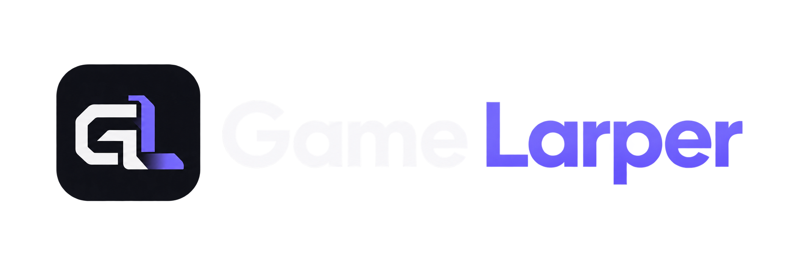

  

<h1 align="center">ROADMAP</h1>

  <strong>La suite du larp, sans boule de cristal. ✨</strong> 
  Les idées, les améliorations et les questions que nous voulons explorer pour Game Larper.

  <a href="#notre-cap">Notre cap</a> ·
  <a href="#expérience-et-ergonomie">Expérience</a> ·
  <a href="#linux-et-compatibilité">Linux</a> ·
  <a href="#fiabilité-et-outils">Fiabilité</a> ·
  <a href="#à-investiguer">Investigation</a> ·
  <a href="#contribuer">Contribuer</a>

---

> [!IMPORTANT]
> **Cette roadmap est une direction, pas une promesse.**
> Les fonctionnalités ci-dessous ne sont liées à **aucune version, date ou échéance**. Leur ordre n'indique pas un ordre de développement. Elles peuvent évoluer, être regroupées, reportées ou abandonnées après discussion et validation technique.

## Notre cap

Game Larper doit rester ce qu'il est : **une petite application locale, rapide et agréable à utiliser**, sur Windows comme sur Linux. On choisit un jeu, on lance un processus de substitution discret, et Discord se charge de la détection.

La suite doit respecter cette philosophie :

- **Simple avant tout.** Pas de fonctionnalités qui compliquent inutilement le parcours « choisir → jouer ».
- **Fiable par conception.** Une session, une queue et des fichiers locaux dont on maîtrise le cycle de vie.
- **Léger et respectueux.** Pas de compte obligatoire, pas de télémétrie imposée, pas de services permanents superflus.
- **Ouvert aux contributions.** Les besoins Windows et Linux comptent tous les deux, même si leurs solutions techniques peuvent différer.

**Comment lire les pistes :** 🟣 **Envisagé** = direction souhaitée, sans calendrier · ⚪ **À explorer** = comportement ou faisabilité à préciser · 🔎 **À investiguer** = problème à mesurer avant de proposer une correction.

---

## Expérience et ergonomie

*Rendre les actions fréquentes plus rapides, sans alourdir l'interface.*

| Piste | Ce que nous aimerions apporter | État |
| :--- | :--- | :--- |
| **Édition de la file d'attente** | Ajuster la durée d'une entrée déjà ajoutée et étudier le réordonnancement par glisser-déposer, tout en conservant les protections pendant l'exécution. | 🟣 Envisagé |
| **Préréglages de queue** | Enregistrer, retrouver et charger des enchaînements de jeux réutilisables, sans reconstruire la file à chaque fois. | 🟣 Envisagé |
| **Organisation des favoris** | Permettre un ordre personnalisé des favoris, notamment dans le panneau tray, sans perdre leur persistance actuelle. | ⚪ À explorer |
| **Contrôles de l'historique récent** | Effacer les jeux récents et étudier une option pour désactiver leur enregistrement local. | 🟣 Envisagé |
| **Position du panneau Settings** | Ajouter un sélecteur **Left / Right** près de **Cancel** et **Save** pour choisir de quel côté les paramètres s'ouvrent, avec mémorisation du choix. | 🟣 Envisagé |
| **Navigation au clavier** | Harmoniser les raccourcis, la navigation entre les éléments et la visibilité du focus dans la fenêtre principale comme dans le tray. | ⚪ À explorer |

---

## Linux et compatibilité

*Améliorer l'expérience des utilisateurs Linux sans supposer que tous les environnements de bureau se comportent de la même façon.*

| Piste | Ce que nous aimerions apporter | État |
| :--- | :--- | :--- |
| **Amélioration du tray Linux** | Éviter qu'une fenêtre devienne difficile à retrouver lorsqu'aucun hôte d'icône tray n'est disponible (notamment certains environnements GNOME). Étudier une expérience plus cohérente avec le panneau Windows, lorsque la plateforme le permet. | 🟣 Envisagé |
| **Compatibilité des bureaux et clients Discord** | Mieux tester, documenter et, lorsque c'est possible, améliorer le comportement sous X11, XWayland et Wayland ainsi qu'avec les différents modes d'installation de Discord. | ⚪ À explorer |

> [!NOTE]
> Le support Linux existe déjà. Ces pistes concernent **son amélioration**, pas l'annonce d'un portage à venir. Les limites liées aux environnements ou aux sandboxs doivent rester documentées avec précision, sans promettre de contournement universel. Voir [la documentation Linux](docs/LINUX.md).

---

## Fiabilité et outils

*Des outils utiles quand tout va bien, et encore plus quand quelque chose ne fonctionne pas.*

| Piste | Ce que nous aimerions apporter | État |
| :--- | :--- | :--- |
| **Diagnostic de détection** | Rendre compréhensibles les vérifications réalisées par Game Larper : chemin utilisé, lancement et état du runner, erreurs éventuelles et informations pertinentes pour le support. **Ne pas prétendre confirmer une détection Discord que l'application ne peut pas observer.** | 🟣 Envisagé |
| **Import / export des données** | Sauvegarder et restaurer les paramètres, favoris et files d'attente. Définir soigneusement ce qui est portable et ce qui doit rester privé ou propre à une machine. | ⚪ À explorer |
| **Gestion du cache** | Étudier une limite de taille ou une politique de nettoyage du cache disque, ainsi qu'une action de nettoyage explicite, sans dégrader la fluidité ni le cache mémoire déjà borné. | 🟣 Envisagé |

---

## À investiguer

### 🔎 Première ouverture des paramètres : légère saccade intermittente

Il arrive que **la toute première animation d'ouverture des paramètres**, après le démarrage de l'application, présente un bref ralentissement. Les ouvertures suivantes semblent fluides et le phénomène **n'est pas reproductible systématiquement**.

**Approche souhaitée :** mesurer les temps du premier affichage à froid puis des ouvertures suivantes, comparer plusieurs lancements et vérifier si l'initialisation de l'interface, le rendu ou le chargement de ressources intervient réellement. **Pas de correction spéculative** tant que la cause n'est pas identifiée.

**État :** 🔎 À investiguer — observation intermittente, aucune cause confirmée.

---

## Ce qui existe déjà

La roadmap prolonge une base fonctionnelle : **recherche de jeux, lancement et contrôle de session, queue, favoris persistants, historique récent et panneau tray personnalisé sous Windows**. Game Larper dispose également d'un support Linux, avec une expérience et des limites propres à cet environnement.

Pour l'état actuel du projet, consulter le [README](README.md), l'[architecture](docs/ARCHITECTURE.md) et les [détails de détection](docs/DETECTION.md).

---

## Contribuer

Une fonctionnalité te semble utile ? Un comportement Linux mérite d'être mieux documenté ? Une idée de cette page gagnerait à être simplifiée ?

**Ouvre une [issue](https://github.com/kyaemma/game-larper/issues/new)** pour en discuter avant une implémentation importante, ou consulte le [guide de contribution](docs/CONTRIBUTING.md). Les propositions doivent rester cohérentes avec la philosophie du projet : simplicité, stabilité et respect de la machine de l'utilisateur.

La roadmap est **vivante**. Elle évoluera avec les retours des utilisateurs et des contributeurs, sans calendrier figé.

---

   
  Pick a game. Press play. La suite, on l'imagine ensemble. 💜

